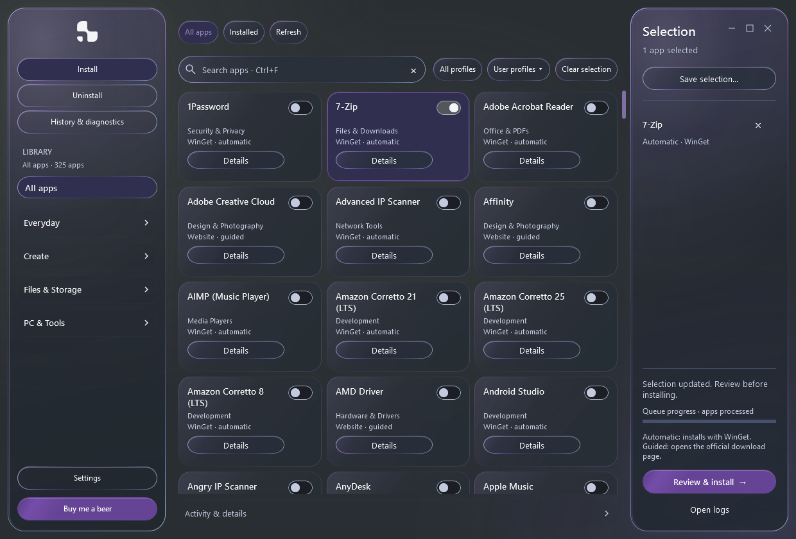
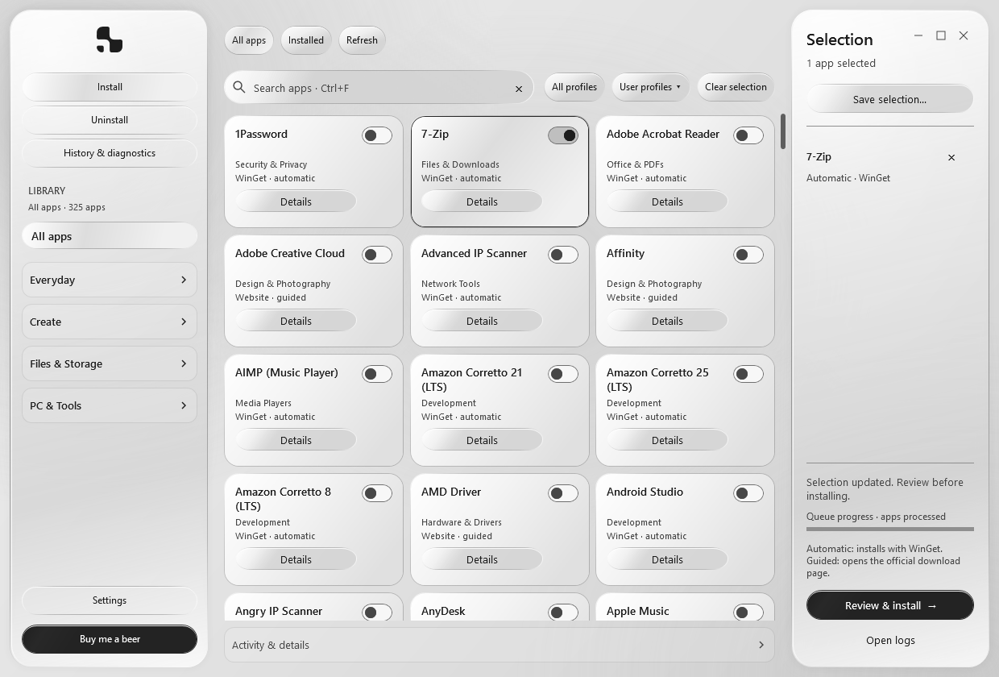
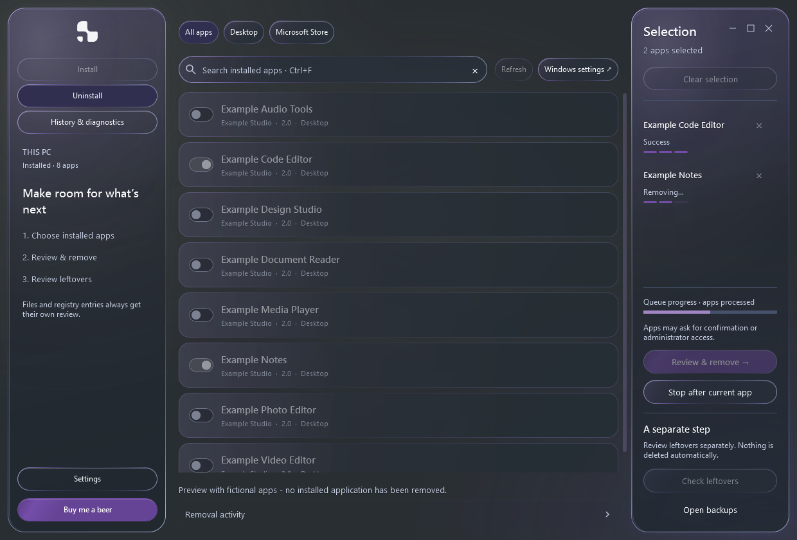
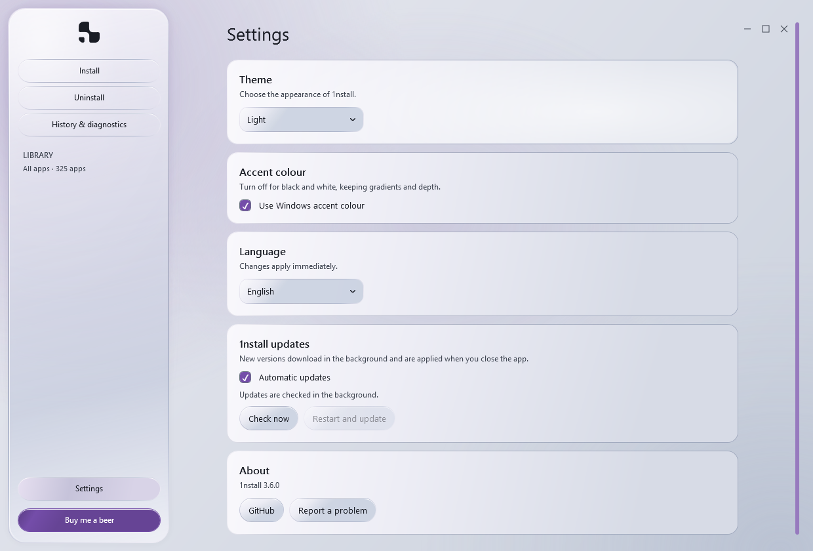

# 1nstall

### Your next Windows setup starts here.

Choose the apps you need, build a setup that fits your work, and keep every installation and removal in view. A Windows app manager with a curated library, reusable profiles and a little delight in the details.

**325 apps · 24 categories · 20 profiles · 51 language choices**

[**Download for Windows**](https://github.com/braga1k/1nstall/releases/latest/download/1nstall.exe) · [Portable ZIP](https://github.com/braga1k/1nstall/releases/download/v3.6.0/1nstall-3.6.0-Windows-x64.zip) · [What's new in 3.6](https://github.com/braga1k/1nstall/releases/tag/v3.6.0) · [Checksums](https://github.com/braga1k/1nstall/releases/download/v3.6.0/SHA256SUMS.txt)

Windows 10 / 11 · x64 · Standalone executable

## A setup that feels like yours

| Choose | Make it yours | Stay in control |
| --- | --- | --- |
| Browse by task, search the library or start from one of 20 profiles. | Light, dark or system appearance. Your Windows accent, or monochrome. | Review each queue before it starts and see individual outcomes. |
| Save a selection and take it to another PC. | 51 language choices, including Japanese and Portuguese from Portugal. | Use original uninstallers and review supported leftovers separately. |

**3.6 makes selection feel more responsive.** Switches in Install and Uninstall lean as you press, stretch as they travel and settle softly. A second click reverses the motion smoothly. Your selection changes immediately; installation and removal still wait for your review.

The same gradients, reflective edges and pointer light run through Install, Uninstall and Settings. Buttons spring back on release, panels reveal their content smoothly, and verified successes receive a soft, whole-window glow. Windows reduced-motion and high-contrast preferences are respected.

## From a fresh PC to your own setup

1. **Open 1nstall.** Download the executable, or extract the portable ZIP. There is no 1nstall installer to run.
2. **Choose your apps.** Search, browse categories or choose **All profiles**. Adjust the list in **Selection**.
3. **Review & install.** Check the plan, then start the queue. Follow publisher installers that need your input.
4. **Keep your selection.** Use **Save selection…** to reuse it later or on another PC.

**277 catalog apps use WinGet.** The other **48 open the publisher's official download page** for guided installation. Confirmed installed apps are dimmed and marked in the library. Apps that cannot be identified confidently remain Unknown.

Profiles and snapshots restore selections. They do not transfer personal files, credentials, app settings or guarantee the same installed versions.

[Explore the catalog](docs/SUPPORTED-APPS.md) · [Profiles and portable selections](docs/PROFILES.md)

## Remove with a clear view of the outcome

Search registered desktop and current-user Microsoft Store apps, select what to remove, then choose **Review & remove**. Original uninstallers run in sequence. Selection follows Preparing, Removing and Verifying states, waits for observed publisher child processes, and retains the outcomes after refresh. **Stop** lets the current operation finish before stopping the queue.

After a verified removal, review supported leftover folders and registry entries separately. Each candidate includes its evidence and disk/registry totals. Nothing is selected or deleted automatically. Folder cleanup uses Recycle Bin; registry changes require backups. Detection is bounded and protects personal folders, shared registrations and reinstalled apps. Name matches still require your review: app data may contain settings, saves or personal work.

**Activity & details**, **Removal activity** and **History & diagnostics** keep results, logs and applicable retries accessible. Diagnostic exports show a preview before you save them.

[Removal scope and recovery](docs/UNINSTALL.md)

## Set the mood. Keep the depth.

- **Appearance:** System, Light or Dark, with optional Windows accent. Changes apply immediately and preserve selections.
- **Language:** 51 offline choices. Portuguese is exclusively **pt-PT**; Arabic and Urdu use right-to-left layout. Translations still need native-speaker review.
- **Automatic 1nstall updates:** checks stable releases, verifies the download and applies it after the app closes, retaining the previous executable. This updates 1nstall itself.

[Settings and updates](docs/SETTINGS.md) · [Language coverage](docs/localization.md) · [Changelog](CHANGELOG.md)

## Before you start

- **Windows 10 or 11, 64-bit**, Windows PowerShell 5.1 and **.NET Framework 4.8 / WPF**.
- **WinGet**, supplied through Windows App Installer, and internet access for automatic app downloads.
- Full installed-package awareness uses **PowerShell 7** in its standard Program Files location and **Microsoft.WinGet.Client 1.7+**. Without them, WinGet export can confirm some identities; omitted apps remain Unknown. Automatic installation still uses WinGet.
- Some installers and machine-level removals request administrator access. Updating 1nstall requires a writable executable folder.

The executable includes the interface, catalog, helpers and licence notices. The release is **unsigned**; SHA-256 checksums accompany the downloads. Native Desktop Acrylic requires a supported Windows 11 build; other systems and disabled transparency use a fallback. The minimum window size is 1040 × 540 DIP.

## Help and troubleshooting

| What happened? | Where to look |
| --- | --- |
| Automatic installation is unavailable | Install or update Windows App Installer, then reopen 1nstall. |
| An operation failed | Open Activity & details, Removal activity or History & diagnostics. |
| A guided app is still missing | Complete the official download and installer opened by 1nstall. |
| No leftovers are offered | Check the scan result; only supported candidates are offered. |
| A saved profile will not load | Its app keys must exist in this catalog. Rejected imports preserve your selection. |
| 1nstall cannot start | Check `%TEMP%\1nstall-startup-error.log`. |

Preferences, logs and backups live under `%LOCALAPPDATA%\1nstall`. Review diagnostic exports before sharing; raw logs may contain personal paths.

[Report an issue](https://github.com/braga1k/1nstall/issues) with your 1nstall version, Windows version and steps to reproduce the problem. Translation corrections and app suggestions are welcome.

## Development

[Build, test and release](docs/DEVELOPING.md) · [Motion implementation](docs/ELASTIC-MOTION.md) · [Validation and remaining coverage](docs/VALIDATION.md)

The repository keeps current documentation and screenshots. Earlier versions remain available in [Releases](https://github.com/braga1k/1nstall/releases) and their Git tags.

## Credits and support

[Buy me a beer](https://ko-fi.com/braga1k) if you'd like to support the project.

The catalog takes inspiration from [WinUtil](https://github.com/ChrisTitusTech/winutil); [recorded coverage](docs/catalog/WINUTIL-COVERAGE.json) identifies the reviewed snapshot. Automatic installation uses [Microsoft WinGet](https://github.com/microsoft/winget-cli). Elastic motion is inspired by [Flowing's toggle article](https://flowing-v4.vercel.app/components/elastic-toggles-1/article).

Selected AppCompat/UserAssist scanners and ROT13 handling are adapted from [Bulk Crap Uninstaller](https://github.com/BCUninstaller/Bulk-Crap-Uninstaller) under Apache-2.0. The licence, upstream NOTICE and modifications are included in [third-party notices](licenses/THIRD-PARTY-NOTICES.txt) and **History & diagnostics > Licenses & credits**.

Third-party apps retain their own licences and account requirements. The project does not currently declare a general licence for its original code.
