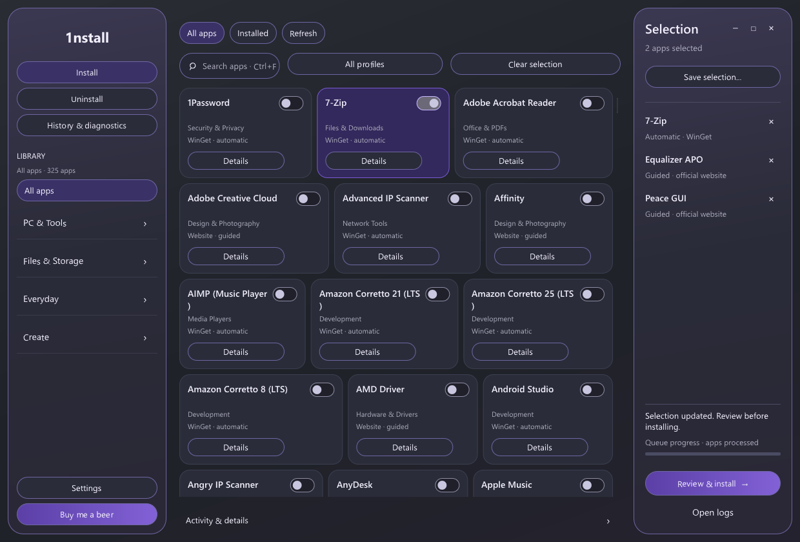
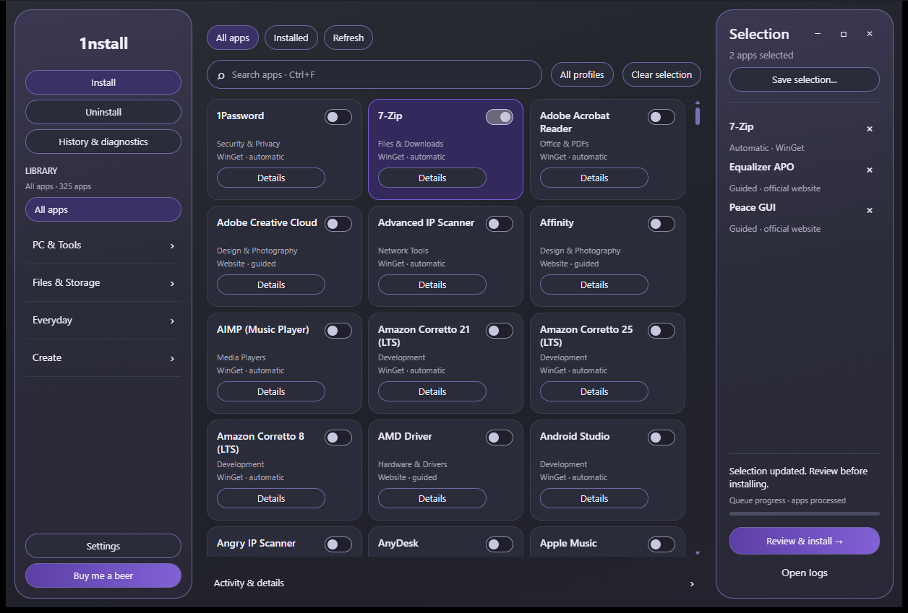
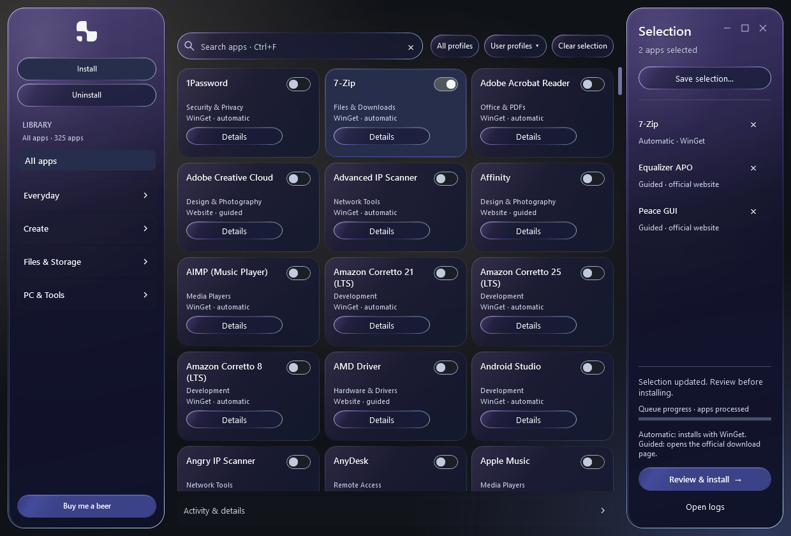
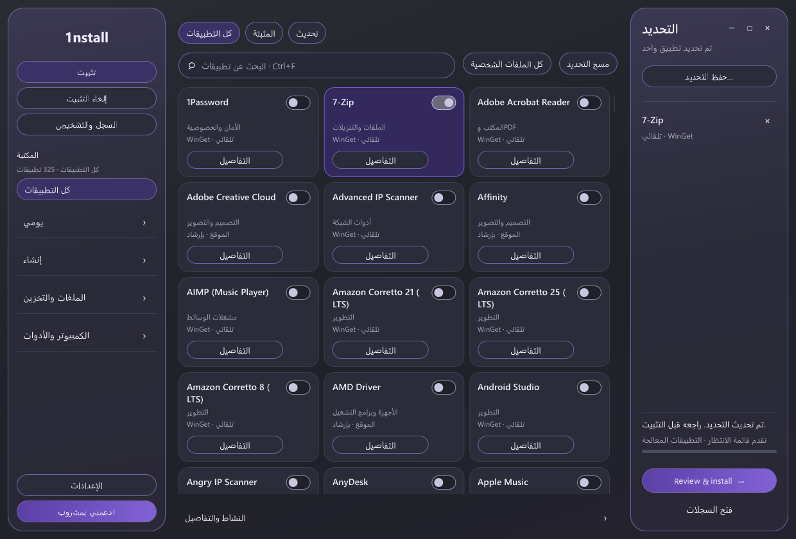
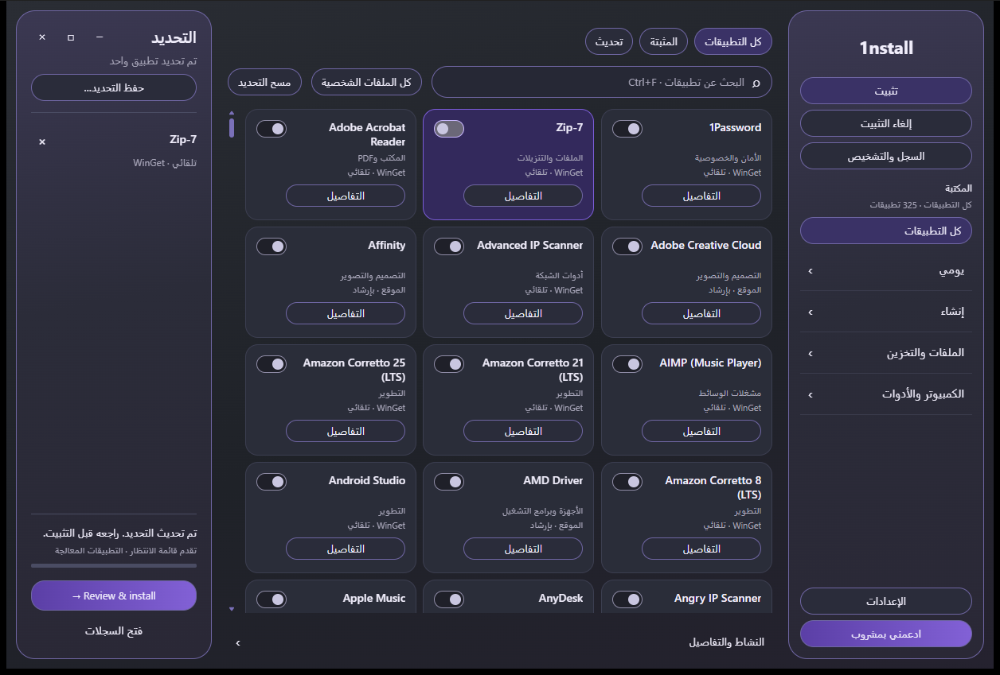

# Fase 3 — Escolha da interface por protótipo

Estado em 2026-11-18. O código está no ramo `v4/ui-prototypes`, pasta `engine/prototypes/`. A decisão é tua; este relatório dá-te as medições e a minha recomendação.

## Resumo

Construí o mesmo ecrã (a biblioteca de instalação, com os 325 cartões) em três tecnologias, todas sobre o mesmo motor Rust, e medi-as neste PC com a régua da Fase 0.

**Recomendo o Slint.** É o único que cumpre o arranque, o tamanho e a ausência de dependências. O limite de memória de 80 MB só é cumprido com o desenho por software, e por pouco. Tem dois custos reais: o espelhamento para árabe e urdu tem de ser feito à mão, e o aspeto e as animações da 3.6 têm de ser refeitos.

## Os três protótipos

Cada um mostra a navegação, a pesquisa, os 325 cartões com interruptor e o painel de seleção. Todos vão buscar ao motor o catálogo, as traduções, a ordem de instalação com dependências e, em segundo plano, as apps já instaladas.

| Protótipo | O que é |
| --- | --- |
| Slint | Interface nativa em Rust, um único executável. Testado com dois modos de desenho: OpenGL e software. |
| Tauri | Página web dentro do WebView2 do Windows, com o motor Rust por trás. |
| WPF sobre Rust | A interface real da 3.6 (`interface.xaml` e os seus ajudantes C#), sem PowerShell, a chamar o motor Rust como DLL. |

Slint:

Tauri:

WPF sobre o motor Rust:

Nas três capturas a seleção é a mesma: 7-Zip e Peace GUI. O Equalizer APO aparece porque o motor o põe à frente do Peace, que depende dele.

## Medições

Mediana de 10 arranques a quente com `--startup-test`, neste PC. A 3.6 foi medida de novo na mesma sessão.

| Métrica | 3.6.0 | Slint (OpenGL) | Slint (software) | Tauri | WPF sobre Rust |
| --- | --- | --- | --- | --- | --- |
| Pronta e ociosa | 1 996 ms | 337 ms | 198 ms (aproximado) | 392 ms | 601 ms |
| Primeira execução | 2 425 ms | 336 ms | 199 ms | 443 ms | 614 ms |
| Vida total do processo, medida de fora | 2 862 ms | 482 ms | 230 ms | 436 ms | 644 ms |
| Pico de working set, todos os processos | 285 MB | 108 MB | 77 MB | 308 MB | 103 MB |
| Pico de memória privada, todos os processos | 275 MB | 144 MB | 62 MB | 158 MB | 111 MB |
| Em repouso após 8 s (working set / privada) | não medido | 121 / 157 MB | 86 / 68 MB | 350 / 192 MB | 106 / 112 MB |
| Processos | 3 | 1 | 1 | 7 | 1 |
| Tamanho do que é distribuído | 2,7 MB | 6,8 MB | 6,8 MB | 5,7 MB | 3,0 MB |
| Precisa, além do Windows | .NET Framework 4.8, PowerShell 5.1 | nada | nada | WebView2 Runtime | .NET Framework 4.8 |

Contra o objetivo aceite na Fase 0:

| Objetivo | Slint (OpenGL) | Slint (software) | Tauri | WPF sobre Rust |
| --- | --- | --- | --- | --- |
| Pronta em menos de 500 ms | Sim | Sim | Sim | Não, por 100 ms |
| Pico abaixo de 80 MB | Não (108 MB) | Sim (77 MB) | Não (308 MB) | Não (103 MB) |
| Executável abaixo de 12 MB | Sim | Sim | Sim | Sim |
| Sem dependências além do Windows e do WinGet | Sim | Sim | Não | Não |

Como ler estes números:

- **O relógio é o mesmo em todos.** Tanto a 3.6 como os protótipos contam desde a criação do processo pelo Windows (`launcher.cs:21-28`). *Corrigido em 2026-11-18: a primeira versão deste relatório dizia, por erro, que o relógio da 3.6 começava mais tarde.*
- **O tempo do Slint por software é aproximado.** Esse modo não avisa quando acaba de desenhar; a marca é tirada duas voltas do ciclo de eventos depois de a janela aparecer.
- **A memória do Tauri soma sete processos.** O working set somado conta mais de uma vez as páginas partilhadas; a memória privada (158 MB) não tem esse defeito. O processo principal sozinho usa 29 MB, mas esse número isolado engana.
- **O WPF teve uma série irregular.** Na primeira série, sete execuções ficaram entre 764 e 1 001 ms, logo a seguir à série do Tauri. As duas séries seguintes deram 600,5 e 602 ms, com variação de 20 ms. Uso essas.
- **O Tauri cria uma pasta de perfil de 14 MB** na primeira execução. No protótipo fica ao lado do executável.
- **Nenhum protótipo foi otimizado.** São uma primeira versão de cada.

## O que mais distingue os três

### Acessibilidade

Um script percorre cada janela pela UI Automation, como faz um leitor de ecrã, procura o cartão «7-Zip», liga-o e confirma que a seleção mudou.

| Verificação | Slint | Tauri | WPF sobre Rust |
| --- | --- | --- | --- |
| O cartão é exposto como caixa de verificação | Sim | Sim | Sim |
| Ligar o cartão por UI Automation funciona | Sim | Sim | Sim |
| Cartões visíveis para o leitor de ecrã | 15 de 325 | 325 de 325 | 325 de 325 |

O Slint só expõe os cartões que estão no ecrã, porque a lista só cria as linhas visíveis. Um utilizador de leitor de ecrã tem de percorrer a lista para chegar aos restantes.

### Idiomas da direita para a esquerda

A 1nstall tem 51 idiomas; dois escrevem-se da direita para a esquerda (árabe e urdu).

| | Slint | Tauri | WPF |
| --- | --- | --- | --- |
| Texto árabe bem desenhado | Sim | Sim | Sim na 3.6; não exercitado no protótipo |
| Disposição espelhada | Não na versão testada | Sim, com um atributo | Sim na 3.6, por `FlowDirection` |

Slint em árabe, sem espelhamento:

Tauri em árabe, espelhado:

No Slint o texto fica correto, mas a navegação continua à esquerda e a pontuação no fim das frases salta para o lado errado. Hindi e japonês ficaram bem desenhados nos dois.

No Tauri, «7-Zip» aparece como «Zip-7» em árabe. É um defeito da minha página (falta isolar a direção dos nomes das apps), não da tecnologia.

### Esforço

| | Slint | Tauri | WPF sobre Rust |
| --- | --- | --- | --- |
| Código deste ecrã | 552 linhas | 347 linhas | 207 linhas |
| Aspeto da 3.6 | Tem de ser refeito | Tem de ser refeito | Já existe |
| Animações elásticas da 3.6 (`motion.cs`, 474 linhas) | Têm de ser refeitas | Têm de ser refeitas | Já existem |
| Interface em Rust | Sim | Só a parte por trás da página | Não: fica C# |

### Dependências e licença

- **Slint.** Foi testada a versão 1.13.1, de setembro de 2025, porque é a mais recente que compila com o Rust 1.86 instalado neste PC. A atual é a 1.19. Tem três licenças à escolha: GPLv3, uma gratuita com obrigação de atribuição, e uma comercial. O repositório não declara licença para o código original, por isso esta escolha tem de ser feita antes de distribuir. Não verifiquei os termos nesta sessão.
- **Tauri.** Depende do WebView2 Runtime. Vem com o Windows 11; no Windows 10, que a 1nstall suporta, não é garantido.
- **WPF.** Mantém a dependência do .NET Framework 4.8, que vem com o Windows 10 e 11.

## Recomendação

**Slint, com desenho por software como predefinição.**

- É o único que cumpre arranque, tamanho e zero dependências.
- Arranca em cerca de 200 ms: a janela principal aparece antes do que hoje aparece a animação de abertura (445 ms).
- A interface fica em Rust, que é o pedido da 4.0.

O que aceitas ao escolhê-lo:

- **Memória no limite.** 77 MB até ficar pronta, 86 MB em repouso. Com OpenGL passa para 108 MB.
- **Árabe e urdu** precisam de espelhamento feito à mão, ou de confirmar se uma versão mais recente do Slint já o faz.
- **O aspeto e as animações** têm de ser refeitos.
- **Leitores de ecrã** só veem os cartões visíveis.

Quando escolheria outro:

- **WPF sobre Rust**, se quiseres a 4.0 mais cedo e com o aspeto intacto. Falha o arranque por 100 ms e a memória por 23 MB, mas é 3,3 vezes mais rápido do que a 3.6 e usa menos de metade da memória. A interface não fica em Rust.
- **Tauri**, se a prioridade for iterar depressa no desenho e ter espelhamento e acessibilidade de origem. Falha a memória por larga margem e traz uma dependência.

## O que não foi medido

- **Fluidez** ao deslocar a lista e nas animações, sobretudo no Slint por software em ecrãs de alta resolução. É o maior risco em aberto da recomendação.
- **Outras máquinas.** Tudo foi medido num único PC topo de gama. A memória do modo OpenGL depende do controlador gráfico.
- **Windows 10**, ecrãs com escalas diferentes e vários monitores.
- **Um leitor de ecrã real.** Só foi verificada a árvore de UI Automation.
- **Os outros ecrãs.** Desinstalação, definições, diálogos e histórico não foram prototipados.

O protótipo WPF não tem os botões de vista no topo nem os de histórico e definições, que na 3.6 são criados pelo script PowerShell. Os números dele são por isso ligeiramente favoráveis.

## Repetir

As instruções estão em [`engine/prototypes/README.md`](../../../engine/prototypes/README.md). Os scripts de medição estão em `engine/prototypes/measure/`.

## Decisões que preciso de ti

1. **O toolkit**: Slint (recomendado), WPF sobre Rust, ou Tauri.
2. **O limite de memória**, se escolheres o Slint: manter 80 MB com desenho por software, ou subir para cerca de 120 MB e usar OpenGL.
3. **A ponte de atualização da 3.6 para a 4.0** (stub .NET ou release-ponte), em aberto desde a Fase 0. Passa a ser necessária na Fase 4.
